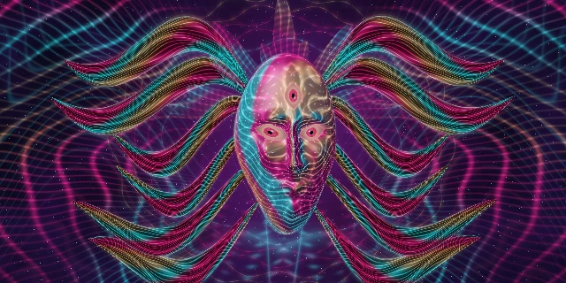

# Fosfeno

Cabina de visuales generativas para proyector. Un rostro de tres ojos, bóvedas fractales, medusas, un nudo tridimensional, metal líquido y un iris abisal comparten el mismo mezclador de imagen y sonido.

[Abrir la cabina](https://luzbel33.github.io/fosfeno/) · [Ver una muestra de 24 segundos](media/fosfeno-demo.mp4)

## Llevarlo a una fiesta

1. Abrí la cabina en una computadora o celular. El **Autopiloto** arranca solo y cambia de escena cada 60 segundos. Tocá el intervalo para elegir desde 15 segundos hasta 4 minutos.
2. En **Audio**, activá el micrófono si querés seguir la música del lugar. También podés importar pistas. Cuando hay señal externa, el análisis de tres bandas reemplaza al pulso interno de 130 BPM.
3. Tocá **Proyectar** para llenar la pantalla con la visual. Si manejás el show desde una notebook con escritorio extendido, usá **Panel → Salida → Abrir ventana de salida**, arrastrala al proyector y hacé doble clic en ella. La cabina conserva los controles. Podés capturar esa ventana en OBS.
4. Para trabajar sin internet, abrí la cabina una vez y esperá **Disponible sin conexión** al pie. También podés descargar el repositorio, descomprimirlo y abrir `index.html`. Conservá las carpetas que lo acompañan.

Los grabadores, dispositivos y archivos pertenecen al navegador donde se está usando Fosfeno. El permiso del sistema aparece cuando elegís conectar un dispositivo. La captura de ventanas y la segunda salida dependen de las capacidades del navegador. En celular, **Proyectar** también admite un modo de pantalla limpia dentro de la página.

## Tres mezclas para probar

**Un serafín hecho de gente.** Elegí Serafín, conectá la webcam en **Panel → Imagen** y activá **Pinceladas**. Con una fusión del 55%, los contornos de la pista atraviesan la cara. Llevá la fusión al 100% para que la pintura del público ocupe el primer plano. **Volver a pintar** reinicia la reconstrucción.

**Una bóveda de metal líquido.** Abrí Catedral infinita. En **Mezcla**, elegí Río de mercurio como segunda escena y subí el cruce al 35%. Sumá eco de video. Mantené el dedo o el mouse sobre la imagen y arrastrá para desplazar la onda de deformación.

**Un instrumento hecho con tu voz.** En **Audio**, tocá **Grabar muestra** y después **Detener y guardar**. Repetí con otra textura. Reproducí ambas tomas en la biblioteca y ajustá sus volúmenes por separado. Cada pista se reproduce en bucle. El botón de descarga te permite conservar el archivo por fuera del navegador.

## Entradas y síntesis

| Control | Comportamiento |
| --- | --- |
| Híbrido | Compone GLSL original, una segunda escena opcional, síntesis Hydra y realimentación de video. |
| Hydra puro | Ofrece seis patches nativos y un editor de expresiones. Aplicá cambios en vivo o restaurá el original. Los cambios de código duran la sesión. |
| Webcams, fotos y videos | La luminancia, el color y los bordes deforman el campo visual. Los videos locales giran en bucle, en silencio. |
| Ventana | Recibe la salida visible de otra aplicación. El audio de la captura participa en el análisis cuando el navegador entrega una pista. |
| Pinceladas | Pinta trazos gruesos al comenzar, afina el detalle y sigue la dirección local de los bordes. El grave modifica el grosor. |
| Biblioteca | Guarda importaciones y grabaciones en IndexedDB. Permite reproducción simultánea, volumen, descarga y eliminación. Los datos persisten en el mismo navegador y origen. |
| Resolución | Auto regula la cantidad de píxeles según el rendimiento. También podés seleccionar un presupuesto equivalente a 540p, 720p o 1080p en formato 16:9. |

En el editor Hydra podés escribir, por ejemplo, `osc(13, .08, 1.4).modulate(src(s0), .22).kaleid(() => 4 + a.fft[0])`. La fuente visual entra por `s0`, el eco por `o0` y las tres bandas por `a.fft`. El editor acepta una expresión por escena y conserva el último patch válido si falla la compilación.

| Atajo | Acción |
| --- | --- |
| 1–6 | Elegir escena |
| ← / → | Anterior o siguiente |
| Espacio | Alternar autopiloto |
| M | Mutar la forma |
| F | Entrar o salir de proyección |

## Desarrollo y referencias

Sitio estático con JavaScript, WebGL y Web Audio. Las escenas comparten el contexto gráfico de Hydra. Las transiciones dibujan ambos mundos durante el fundido y reutilizan los programas compilados. Audio y video se procesan en el dispositivo.

Para servirlo localmente, ejecutá `python -m http.server 8000 --bind 127.0.0.1` desde esta carpeta y abrí `http://localhost:8000`. La web pública usa HTTPS para habilitar cámara y micrófono en celulares. Al publicar cambios, actualizá la versión de la caché en `sw.js` para que se descargue la nueva edición.

- El motor incluido es **hydra-synth 1.4.0** de Olivia Jack y colaboradores. *Glitch River*, de Flor de Fuego, inspiró el uso de osciladores, voronoi y memoria de imagen. [Fuente del motor distribuido](https://github.com/hydra-synth/hydra-synth/tree/c3ba80bd82f096e0ef7a9b7022e72c04162c25c4) · [Sketch de referencia](https://hydra.ojack.xyz/?sketch_id=flor_2)
- La separación entre entradas, módulos y mezcla toma como referencias el entorno modular de modV y la tradición de presets musicales de projectM. [modV](https://github.com/vcync/modV) · [projectM](https://github.com/projectM-visualizer/projectm)
- La reconstrucción pictórica implementa un pincel incremental propio, inspirado en el trabajo de Aaron Hertzmann sobre orientación de trazos y escalas de pincel. [Painterly Rendering with Curved Brush Strokes of Multiple Sizes](https://mrl.cs.nyu.edu/publications/painterly98/)

Fosfeno se distribuye bajo **GNU AGPL v3**. Las tipografías Barlow Condensed y Space Mono se distribuyen bajo SIL Open Font License. [Licencia del código](LICENSE) · [Barlow Condensed](assets/LICENSE-Barlow.txt) · [Space Mono](assets/LICENSE-SpaceMono.txt)
