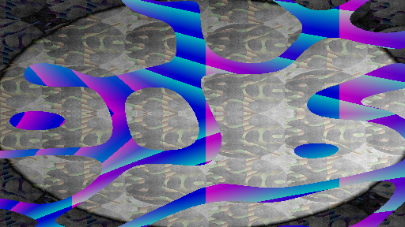

# Comparación de Fosfeno con Hydra

Prueba local del 23 de noviembre de 2026 en Windows y Chromium 148.0.7778.96. Se abrió el sitio público de Hydra y la copia de Fosfeno servida por localhost en contextos de navegador independientes. El alcance medido fue el documento inicial, la evaluación desde el editor, los operadores, las entradas y la salida WebGL.

## Qué abre el sitio oficial

La portada sin parámetros elige al azar una entrada de la galería. Tres sesiones nuevas mostraron *tropical juice* (`ritchse_2`), *MULTIVERSE* (`eerie_ear_0`) y *egg of the phoenix* (`alexandre_2`). Las comparaciones abren `?sketch_id=eerie_ear_0` explícitamente en ambos editores para repetir la misma pieza. La portada de Fosfeno genera una pieza a partir de una semilla aleatoria. [Selección y preparación del código de Hydra](https://github.com/hydra-synth/hydra/blob/523e0feaf3f49899b759ce0e7afabe0114ddfe2b/src/stores/gallery.js#L129-L205)

Se leyó el documento de CodeMirror de Hydra y se comparó con el de Fosfeno. Ambos contenían los mismos 811 bytes UTF-8, incluidos comentarios y saltos de línea finales. El SHA-256 es `dc19d3a78597e4611844e73f6775700ee004031c504d8821a02871e46a43076d`. Al recuperar un borrador personal, Fosfeno conserva el texto del operador. [Abrir el original de e_e (@eerie_ear)](https://hydra.ojack.xyz/?sketch_id=eerie_ear_0)



El PNG fue idéntico en ambos editores a 512 × 288, con el reloj iniciado en 15 segundos, los buffers vacíos y 48 pasos de 1/60 s. La imagen y el sketch se atribuyen a e_e (@eerie_ear) bajo CC BY-NC-SA 4.0. [Licencia de la pieza](https://creativecommons.org/licenses/by-nc-sa/4.0/)

## Del editor desplegado a WebGL

Con REA se inspeccionaron dos pestañas de un Chromium dedicado, una en la portada oficial y otra en localhost. Se analizaron los tres scripts observados de la página desplegada. Los tres se pudieron parsear. Estas huellas identifican el código que recibió ese navegador. [Editor desplegado](https://hydra.ojack.xyz/) · [Repositorio del editor](https://github.com/hydra-synth/hydra/tree/523e0feaf3f49899b759ce0e7afabe0114ddfe2b)

| Script de Hydra | Bytes | SHA-256 |
|---|---:|---|
| `assets/index-1010dfdc.js` (editor) | 901128 | `3b66efc9d63eef2effd050afe0bacdc2defa6169fd2ea688c7c3a8d0b62af195` |
| `hydra-synth/dist/hydra-synth.js` (motor) | 208483 | `b4881aa9dfbd990a9e37fe6766581816fc273cdd42471e13bf6e79b705a5a7a1` |
| `p5.js/1.4.0/p5.min.js` | 814950 | `10cd93ab7811ce2c8cca0666ae3e205bab8c7128f9b7acfe0ded3e78d4b27d63` |

Evidencias de sesión de REA: pestañas `ev_c51d68273bdaa06db33f99e72715bb2488a44fdb1f11a5c1f57d55341d70a790`, bundle desplegado `ev_ea048463692bc87d9fb693d870aaa26084438a838dd9ced9c9997697bec9c9b8` y comparación pasiva `ev_99e04c58e3c26a0799dbc9f56070f5115791577df2b2d60d9122bec9aee82d04`. Esta última registró estructuras de página distintas. La observación pasiva empezó después de la carga y dejó incompleta la comparación de red. Las comprobaciones de ejecución siguientes se hicieron con Playwright.

**Edición e historial.** En la web oficial, ejecutar una línea, un bloque o el documento marcó el fragmento en CodeMirror. Sólo la ejecución completa añadió una entrada de historial con el código codificado mediante `btoa(encodeURIComponent(texto))`. Atrás y Adelante repusieron el texto y volvieron a ejecutar el sketch. Antes del cambio, Fosfeno ejecutaba el código pero mantenía la misma dirección. En la prueba posterior coincidieron los parámetros de URL, el número de entradas, el orden de seis ejecuciones y los colores verde y rojo recuperados al navegar. En Fosfeno también se probó que un error de sintaxis o un cambio en edición en vivo conservara el historial y que la recarga recuperara un borrador sin ejecutarlo. [Evaluación del editor](https://github.com/hydra-synth/hydra/blob/523e0feaf3f49899b759ce0e7afabe0114ddfe2b/src/stores/editor-store.js) · [Codificación e historial](https://github.com/hydra-synth/hydra/blob/523e0feaf3f49899b759ce0e7afabe0114ddfe2b/src/stores/gallery.js)

**Renderizado.** Se ejecutaron desde CodeMirror un oscilador fijo y un sketch que alimenta `o1` con `o0` y con una copia escalada de su propio cuadro anterior. En cada aplicación se registraron tres pasadas compiladas, ocho pasos de reloj y 40 llamadas WebGL a `drawArrays`. En cada paso se actualizaron `s0…s3`, se dibujaron las cuatro salidas y se compuso el canvas. El GLSL generado coincidió con los shaders vinculados a los programas activos. También coincidieron los uniformes y las texturas efectivamente conectadas. La realimentación leyó de la textura opuesta a la que se estaba escribiendo. Con el tiempo detenido, el oscilador fijo produjo un solo hash de imagen. Al pasar por las frecuencias 4, 7, 7 y 11 con feedback se obtuvieron cuatro imágenes distintas, idénticas entre aplicaciones en cada paso. [Motor de Hydra](https://github.com/hydra-synth/hydra-synth) · [Prueba de renderizado](../scripts/trace-render.cjs)

## Pruebas en navegador

Se ejecutó cada programa con **Ctrl + Shift + Enter** desde CodeMirror. Para comparar las imágenes se fijaron el tamaño del buffer, el reloj inicial, el puntero, los valores de audio, la semilla aleatoria y el contenido inicial de las dos texturas de cada salida. Después de ejecutar el código se avanzó el motor por pasos. En los cuadros 1, 6 y 12 se leyó todo el RGBA del canvas compuesto y de `o0…o3`. La resolución habitual de la prueba fue 96 × 64. Un caso llamó a `setResolution(80,48)`.

| Recorrido | Resultado observado |
|---|---|
| Galería oficial | Los 58 programas se ejecutaron en los dos editores. Coincidieron los hashes de las imágenes en los tres cuadros medidos para cada programa, incluidos `flor_2`, `flor_1` con cámara simulada y el preset de arranque. |
| Funciones y parámetros | Coincidieron las 52 definiciones registradas, su GLSL y sus parámetros predeterminados. También se ejecutó una prueba por operador, con una segunda textura para los operadores de mezcla y modulación. |
| Once casos adicionales | Coincidieron oscilador con rotación y pixelado, vista de cuatro buffers, GLSL personalizado con secuencias y callbacks, auxiliares de audio, canvas de p5, imagen, video WebM, cámara con parámetros de textura, captura de pantalla simulada, reloj y resolución desde código, y carga asíncrona de un script de prueba. |
| Total visual | **121 de 121 comparaciones** coincidieron. En 118 hubo color en la salida compuesta. En tres, ambos renders compuestos fueron negros en los cuadros muestreados. En los tres se compararon además los cuatro buffers. |
| Edición | Con Edición en vivo desactivada, escribir dejó intacta la salida hasta ejecutar. Se verificaron por teclado la línea, el bloque, el documento completo, comentar/descomentar y el formateo. Las cuatro bandas y los 30 BPM iniciales coincidieron. |
| Análisis de audio | Con los mismos datos de sonoridad de prueba coincidieron `fft`, `bins`, volumen, `setBins`, suavizado, corte, escala por banda, `a2(escala, desplazamiento)`, `onBeat` y el estado de `a.show()/hide()`. Una prueba adicional en Fosfeno recorrió micrófono simulado → analizador Meyda → grabación → biblioteca → reproducción → silencio. |
| Cámara física | Sólo en Fosfeno, con un perfil de prueba autorizado, se eligió **Integrated Camera** por nombre. Entregó cuadros a 960 × 540, medidos en `o0`, sin abrir el micrófono. **Quitar** liberó la pista. Las pruebas comparativas en el sitio público usaron una cámara sintética. |
| Sustitución y permisos | Con dos cámaras de prueba, Chromium denegó el permiso y luego permitió conectar, elegir y cambiar de cámara. Antes de la corrección, pasar de `initScreen()` a `initCam(0)` dejaba viva la pista de pantalla. Tras el cambio, esa pista terminó. Reemplazar la cámara por canvas, imagen o video también la liberó. La pantalla de esta prueba era un flujo sintético. La prueba con cámara integrada usó permiso concedido por automatización y no guardó imágenes. |
| Regresiones de Fosfeno | Se probaron el pulso opcional y su apagado, la selección entre dos cámaras simuladas, pinceladas y señal directa, la resolución de sketch tras redimensionar la ventana, el retorno a la calidad del panel, la ventana de proyección, la recarga offline, el catálogo y los enlaces con código. La suite de Node cubre además cámara exclusiva, solicitudes canceladas y liberación tras fallos. |

### Video entre dos instancias

Se probó WebRTC con señalización Socket.IO restringida a `127.0.0.1`, sin STUN/TURN y con colores generados por los sketches. Dos Fosfeno se descubrieron por nombre, recibieron verde en una dirección y rojo en la otra, y liberaron la fuente al desconectar. Se verificaron los colores en los buffers después de la decodificación.

También se redirigió el cliente del editor oficial al mismo servidor local. En su entorno de página original apareció `process is not defined` y se interrumpió la negociación. Al aportar el adaptador de navegador de `process` **sólo en esa página de prueba**, pasó el envío en ambos sentidos. Ese resultado verifica el protocolo bajo esa condición. La interoperabilidad con la sala pública sigue sin verificar. [Cliente oficial de señalización](https://github.com/hydra-synth/hydra/blob/523e0feaf3f49899b759ce0e7afabe0114ddfe2b/src/lib/patch-bay/rtc-patch-bay.js) · [Protocolo de nombres](https://github.com/hydra-synth/hydra/blob/523e0feaf3f49899b759ce0e7afabe0114ddfe2b/src/lib/patch-bay/pb-live.js)

## Diferencias y límites

- Fosfeno mantiene el lienzo y el editor en espacios separados. La resolución del escenario y la posición física del puntero pueden diferir a igual tamaño de ventana. Un `setResolution` explícito se mantiene hasta elegir una calidad en el panel.
- En Chromium se recorrieron 16 tamaños entre 280 y 1920 píxeles de ancho, en vertical y apaisado. En la ventana de 375 × 812 la visual ocupó 628 píxeles de alto al abrir. Se comprobó que las herramientas y sus botones quedaran dentro del ancho disponible, que se pudiera leer la última definición de la guía y que Ampliar devolviera al editor. La prueba adicional con entrada táctil emulada incluyó arrastrar la división, leer y cerrar la guía con un zoom del 200 % y volver a abrir la cabina y la ayuda sin conexión.
- El mismo recorrido de interfaz pasó en Firefox y WebKit de Playwright a 320 × 568, 375 × 812, 844 × 390 y 1440 × 900 en Windows. La comparación de píxeles con Hydra se hizo en Chromium.
- La cabina abre el micrófono a pedido. El pulso de reemplazo empieza apagado. Las pistas importadas y la señal compartida pueden alimentar el mismo analizador. La comparación de bandas usó una entrada controlada y excluye las diferencias de acústica, hardware y procesamiento del navegador.
- El panel de cámara conserva su preferencia de 960 × 540 y la vista previa. Desde el código, `initCam` deja negociar al navegador como en Hydra y permite esperar el primer cuadro con `await`. Queda pendiente probar la interacción de una persona con el diálogo nativo de permisos.
- Fosfeno conserva las variables declaradas entre bloques, el último programa de salida válido ante errores de compilación y la opción de ejecutar al escribir. En una sesión nueva la edición en vivo está encendida por pedido de Gian. Para comparar los atajos manuales el ensayo selecciona el modo manual en Fosfeno. Los enlaces con código arbitrario esperan una ejecución explícita.
- La apertura por identificador cubre los ejemplos incluidos. La galería pública de usuarios, su publicación, el directorio de extensiones y las mutaciones del editor oficial quedan fuera de la equivalencia verificada.
- Quedan sin probar Safari, dispositivos iOS y Android físicos y sus teclados en pantalla, otras GPU, dos cámaras físicas simultáneas, el selector nativo de captura de escritorio, MIDI externo, grabación de salida prolongada, servicios remotos de terceros y una sesión de toda la noche. Las coincidencias de cuadros corresponden a las entradas y tiempos indicados.

## Mezcla y proyección por sectores

El compositor opcional se ejecuta después de que Hydra presenta la salida elegida. Con una lista vacía conserva el render de referencia. Para validar la mezcla se leyeron píxeles dentro y fuera de regiones superpuestas y del video decodificado en la ventana de proyección. Las guías de edición se dibujan en otro canvas.

El 26 de noviembre se repitió en localhost la prueba que antes había quedado bloqueada por una cámara ocupada. En un perfil desechable de Chromium 148.0.7778.96 se concedió permiso desde Playwright y se eligió por nombre la **Integrated Camera** física. Entregó video de 960 × 540 a `s0`. Se compararon tres puntos de la composición con la mezcla esperada, 65 % de señal y 35 % de fondo rojo. `o0` conservó el rojo y el editor conservó el código. Se comprobó que el tiempo de video avanzaba y que desconectar terminaba la pista. La prueba abrió sólo video y conservó únicamente medidas. Quedan pendientes la interacción manual con el diálogo del navegador y un proyector físico. [Prueba de entradas](../scripts/check-inputs.cjs)

En otra ejecución, con **dos cámaras simuladas**, se denegó y se concedió permiso, se cambió de cámara y se comprobó la liberación de las pistas. El pulso estuvo apagado al abrir y los valores de `a.fft` volvieron a cero después de activarlo y desactivarlo. Los ensayos contra el editor público usaron dispositivos simulados.

Con un archivo verde sobre fondo rojo se midieron píxeles antes y después de trasladarlo de **Toda la visual** a un sector en modo manual. La salida cambió al aplicar. Deshacer recuperó la mezcla y quitar la fuente devolvió el rojo en todo el escenario. Otra prueba reemplazó `s0` mientras un video trasladado seguía reproduciéndose en el sector. Al retirar la última ruta se detuvo el mismo reproductor y se revocó su URL. También se comprobaron guardado y recuperación de la fuente, migración de la mezcla heredada y código propio que usa `s0` mediante una variable. Son pruebas locales del compositor de Fosfeno. [Prueba de ruteo global](../scripts/check-global-input.cjs)

Chromium headless ejecutó la API de administración de ventanas sobre **monitores virtuales**. El primer toque en **Proyectar** inició la consulta de pantallas. Con un único monitor externo y permisos concedidos por DevTools, la ventana pública entró en pantalla completa allí con un clic. Con dos monitores externos disponibles, Fosfeno pidió elegir. La cabina conservó sus coordenadas. Se probaron también el doble clic, la cancelación del selector, el permiso denegado y la desconexión y reconexión del monitor. Para el movimiento ignorado, la API ausente y la apertura bloqueada se simuló esa limitación específica. [Prueba de pantallas y salidas](../scripts/check-projector-display.cjs)

Con una salida del Estudio abierta, pasar a Mapeo conservó el video. **Proyectar** lo reemplazó por el canvas del mapa en esa misma ventana y la pista anterior terminó. Al cerrar Mapeo se liberó ese contexto WebGL y volvió un video en vivo del Estudio. También se verificó que una ventana pública navegada a otra página conserve su ubicación y la aplicación abra una salida nueva. [Prueba del traspaso entre mesas](../scripts/check-projector-display.cjs)

La prueba de portabilidad pasó entre dos perfiles de Chromium con almacenamiento independiente. El primero exportó una máscara deformada con una imagen azul, inversión al 25 % y código con un ángulo negativo. El segundo importó el archivo, activó la composición y reprodujo los colores medidos dentro y fuera del contorno. También insertó el operador guardado en otra cadena conservando el ángulo y los créditos. Un archivo truncado dejó intacta la biblioteca.

## Repetir la comparación

1. Desde la raíz, ejecutá `node --test`. Esta suite no necesita dispositivos ni conexión.
2. Serví la carpeta con `python -m http.server 8736 --bind 127.0.0.1`. Con Playwright resolvible por Node, Chromium instalado y FFmpeg en el PATH, ejecutá `node scripts/compare-hydra.cjs`. También admite la URL local como argumento. Esta prueba necesita acceso al editor oficial y usa dispositivos de prueba.
3. Para el recorrido de red, con `socket.io@2.5.1` resolvible por Node, ejecutá `node scripts/compare-streams.cjs`. La opción `--official` usa una pestaña oficial. Agregar `--process-shim` reproduce la prueba con el adaptador y requiere `process/browser.js`. El servidor de señalización se crea en loopback y se cierra al terminar.
4. Con el mismo servidor y Chromium, ejecutá `node scripts/compare-editor-history.cjs` y `node scripts/trace-render.cjs` para repetir la comparación de navegación y la inspección de shaders, uniformes y buffers.
5. Ejecutá `node scripts/check-inputs.cjs` para permisos, sustitución de entradas y pulso con dispositivos simulados. Agregá `--physical` para probar además una cámara real en localhost. El script imprime el nombre, las dimensiones y el resultado de liberación.
6. Ejecutá `node scripts/check-mixer.cjs` para probar mezcla, sectores, ventanas y controles desde la interfaz.
7. Ejecutá `node scripts/check-layout.cjs` para tamaños de pantalla, ayuda, ampliación, gestos y recarga sin conexión. Con `firefox` o `webkit` como argumento se repite el recorrido de interfaz en esos motores.
8. Ejecutá `node scripts/check-portable.cjs` para repetir la transferencia de composiciones y operadores entre perfiles. Admite una URL de la cabina como argumento.
9. Ejecutá `node scripts/check-layers.cjs` para probar las ayudas ancladas, el feedback privado con los cuatro buffers principales ocupados, los sliders, el video grabado de un sector, pinceladas en los dos sentidos y la desconexión con una cámara simulada.

## Procedencia del código

- La web oficial sirvió `hydra-synth@1.4.0`. El bundle base coincidió byte por byte con el que tenía Fosfeno, con SHA-256 `b4881aa9dfbd990a9e37fe6766581816fc273cdd42471e13bf6e79b705a5a7a1`. El bundle local actual expone la clase de audio, permite conectarla a una mezcla sin pedir micrófono en el constructor y conserva el soporte de Fosfeno para más bandas que las disponibles en Meyda. Los shaders provienen del motor. [Motor oficial](https://github.com/hydra-synth/hydra-synth) · [Distribución de referencia](https://cdn.jsdelivr.net/npm/hydra-synth@1.4.0/dist/hydra-synth.js)
- El catálogo incluido conserva los registros de la revisión `523e0fe` del editor oficial. Fosfeno usa la misma regla para añadir la cabecera CC BY-NC-SA 4.0 al mostrar y exportar cada sketch. [Datos originales](https://github.com/hydra-synth/hydra/blob/523e0feaf3f49899b759ce0e7afabe0114ddfe2b/src/stores/examples.json)
- p5.js 1.4.0 se distribuye localmente con su licencia. El constructor `P5` adapta el wrapper oficial a un script clásico. El formateador es js-beautify 1.14.8 y el atajo de comentarios usa el complemento de CodeMirror 5.65.18. [p5.js](https://github.com/processing/p5.js/tree/v1.4.0) · [Wrapper de Hydra](https://github.com/hydra-synth/hydra/blob/523e0feaf3f49899b759ce0e7afabe0114ddfe2b/src/lib/p5-wrapper.js) · [Atajos de referencia](https://github.com/hydra-synth/hydra/blob/523e0feaf3f49899b759ce0e7afabe0114ddfe2b/src/views/editor/keymaps.js)
- En `vendor/patch-bay` están el núcleo RTC oficial con la inicialización de `settings` para uso autónomo, el adaptador de globals y los avisos de dependencias. Para reconstruir `client.js`, usá las dependencias del lockfile oficial en `NODE_PATH` y ejecutá desde la raíz el comando siguiente con esbuild 0.27.0. [Lockfile de referencia](https://github.com/hydra-synth/hydra/blob/523e0feaf3f49899b759ce0e7afabe0114ddfe2b/package-lock.json) · [Avisos de terceros](../vendor/patch-bay/THIRD-PARTY.txt)

```sh
esbuild vendor/patch-bay/rtc-patch-bay.js --bundle --platform=browser --global-name=HydraPatchBay --define:global=globalThis --inject:vendor/patch-bay/browser-globals.js --minify --legal-comments=eof --outfile=vendor/patch-bay/client.js
```
